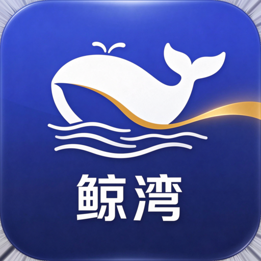
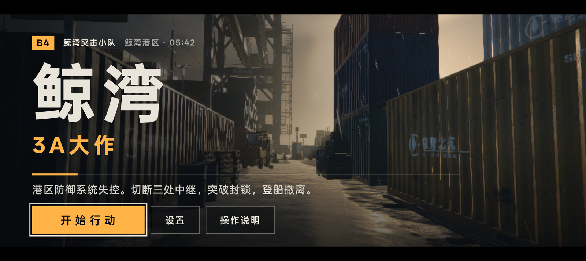

# others

杂项仓库：放一些零散的小项目、小工具。第一个产物是《鲸湾》安卓版。

## 《鲸湾》1.0 · 安卓 APK

浏览器 3D 第一人称射击小游戏《鲸湾》（Three.js + WebGL）的安卓壳版本：场景、模型、音效全部打包在 APK 里，**完全离线**，装到桌面直接玩。

### 特性

- **完整离线**：港口场景、机械飞鸥 / 机械猎犬、三处中继任务、撤离结算，全在本地运行
- **全屏沉浸**：隐藏状态栏与导航栏，刘海屏 / 手势条安全区自适应
- **屏幕方向自己选**：跟随系统 / 横屏 / 竖屏（设置 → 屏幕方向）
- **触屏按键可 DIY**：每个按键的位置、大小、透明度都能单独调，编辑条可拖动可收起，布局存本机
- **开镜方式两档**：按住开镜（松手回腰射）或点击切换
- **无敌模式**：血量与弹药无限（练习、截图用）
- 返回键 = Esc（出暂停菜单），1.5 秒内连按两次退出

### 安装

下载 Release 里的 `jingwan.apk` 直接安装（自签名，需要允许「安装未知来源应用」）。

| 项 | 值 |
| --- | --- |
| 包名 | `chen9183.github.jingwan` |
| 版本 | 1.0（versionCode 1） |
| 最低系统 | Android 7.0（API 24） |
| 体积 | 约 825 KB |

### 说明

- 升级必须使用同一把签名密钥，否则需要先卸载旧版再安装。
- 网页版单文件也随 Release 提供（`jingwan-web-1.0.html`），浏览器直接打开即可游玩。
- 触屏布局、画质、屏幕方向等设置都保存在本机，卸载即清空。
